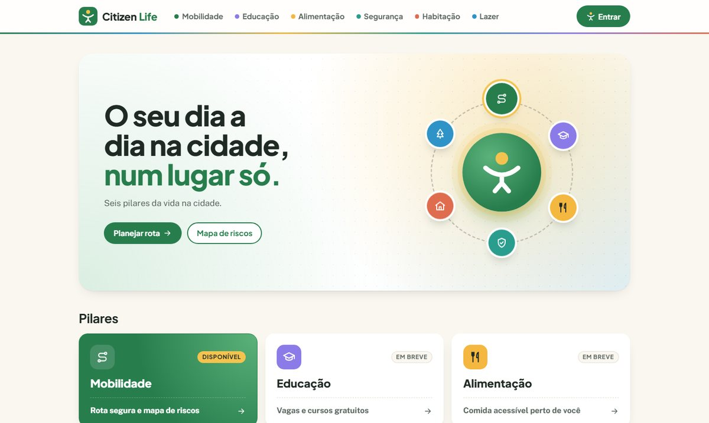
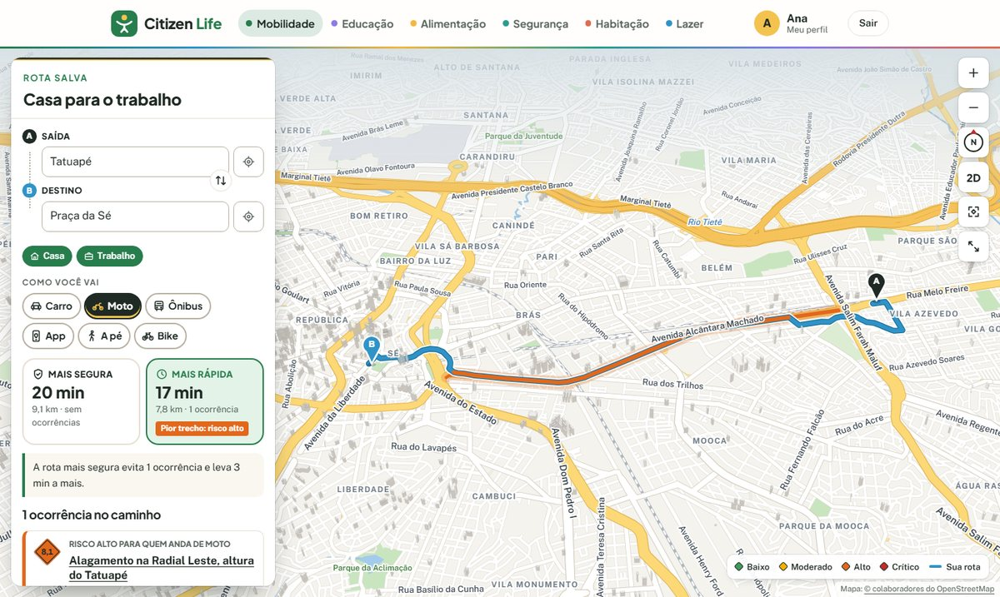
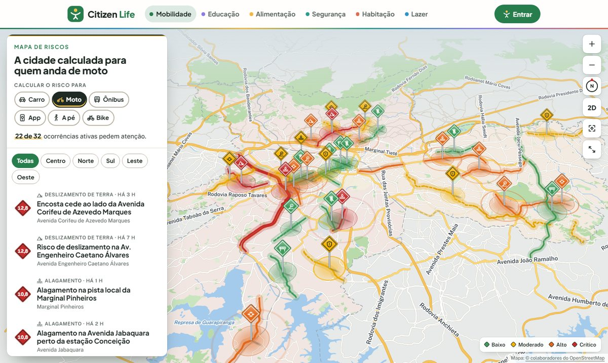
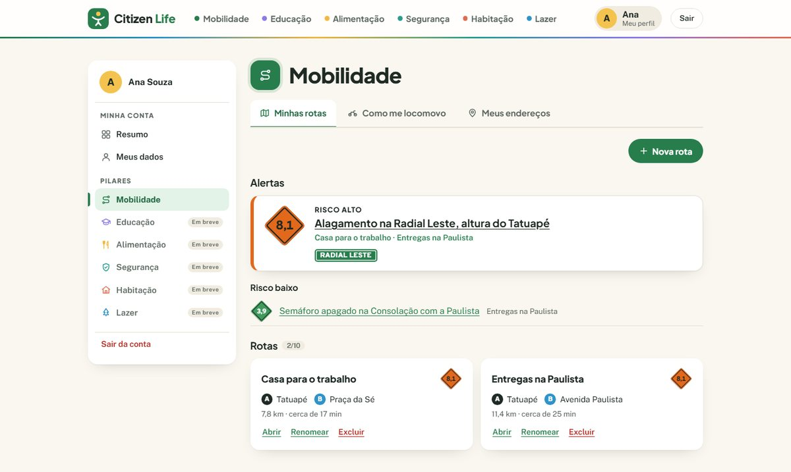
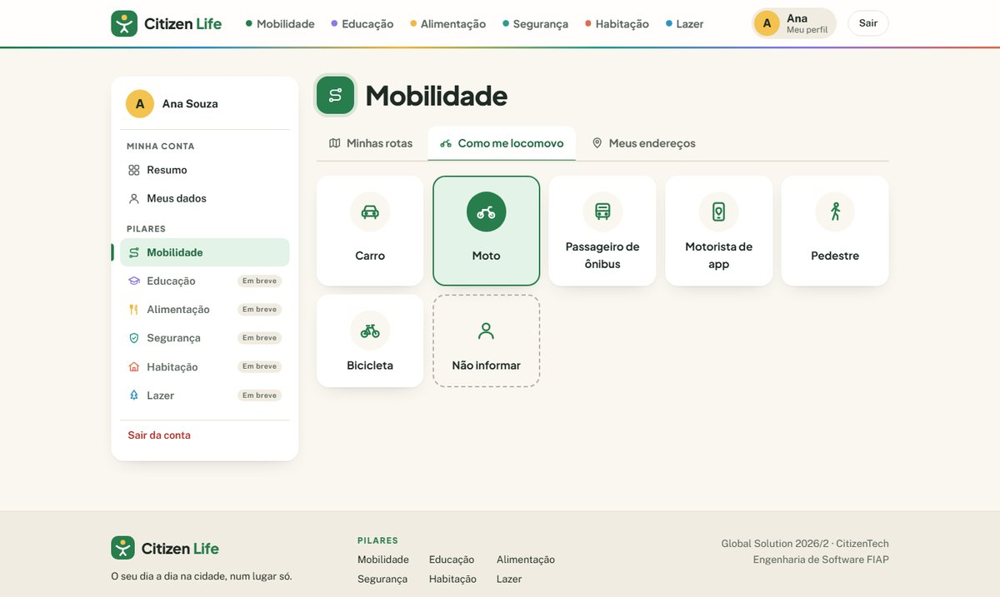
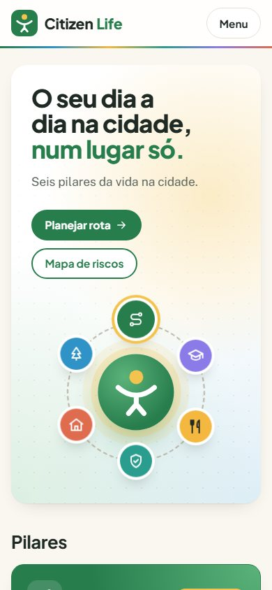
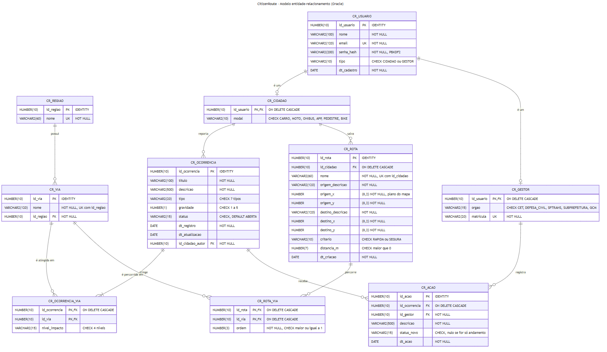

<div align="center">


# Citizen Life

**O seu dia a dia na cidade, num lugar só.**

Um hub com seis pilares da vida urbana. Na **Mobilidade**, a rota da saída ao destino<br />
com o risco do caminho calculado para o seu meio de transporte.


Global Solution 2026/2 · tema **CitizenTech** · Engenharia de Software FIAP (2ESOA)

**[▶ Vídeo pitch](#)** _(cole aqui o link público)_ · **[Como executar](#-como-executar)** · **[Guia do código](docs/GUIA-DO-CODIGO.md)**

<br />



</div>

---

## Sumário

- [O problema](#-o-problema)
- [A solução](#-a-solução)
- [Telas](#-telas)
- [A regra do risco](#-a-regra-do-risco)
- [ODS da ONU](#-ods-da-onu)
- [Como executar](#-como-executar)
- [Tecnologias e arquitetura](#-tecnologias-e-arquitetura)
- [Banco de dados](#-banco-de-dados)
- [Diagramas](#-diagramas)
- [Identidade visual](#-identidade-visual)
- [Próximos passos](#-próximos-passos)
- [Validação com pessoas reais](#-validação-com-pessoas-reais)
- [Integrantes e uso de IA](#-integrantes-e-uso-de-ia)

---

## 🧭 O problema

A informação que o cidadão usa para viver a cidade está espalhada: o trânsito num aplicativo, os alagamentos no noticiário, a feira e o posto de saúde no site da prefeitura, cada um com uma linguagem.

E ela costuma ser igual para todo mundo, quando não deveria. **O mesmo alagamento é lentidão para quem está de carro e risco de queda para quem está de moto, a pé ou de bicicleta.**

## 💡 A solução

O Citizen Life reúne seis pilares da vida na cidade. Cada um começa por uma **primeira consulta**: a resposta que mais ajuda no dia a dia.

| | Pilar | Primeira consulta | |
|:-:|---|---|:-:|
| 🧭 | **Mobilidade** | Rota segura e mapa de riscos | ✅ **pronto** |
| 🎓 | Educação | Vagas e cursos gratuitos | 🚧 em breve |
| 🍴 | Alimentação | Comida acessível perto de você | 🚧 em breve |
| 🛡️ | Segurança | Onde pedir ajuda perto de você | 🚧 em breve |
| 🏠 | Habitação | Programas de moradia para você | 🚧 em breve |
| 🌳 | Lazer | Programação gratuita por região | 🚧 em breve |

Na **Mobilidade**, o cidadão:

- 🗺️ **planeja a rota** da saída ao destino e escolhe como vai (carro, moto, ônibus, aplicativo, a pé ou bicicleta). Recebe a rota **mais rápida** e a **mais segura**, que desvia das vias perigosas para aquele meio de transporte;
- 🚨 **vê o mapa de riscos**: São Paulo em 3D com as ocorrências ativas (alagamento, acidente, queda de árvore, semáforo apagado, deslizamento, via bloqueada, insegurança) na cor do risco;
- 👤 **guarda tudo no perfil**: rotas do dia a dia com alertas, o meio de transporte e endereços como casa e trabalho, que viram atalhos na hora de planejar.

---

## 📱 Telas

<table>
  <tr>
    <td width="50%"></td>
    <td width="50%"></td>
  </tr>
  <tr>
    <td><b>Planejar rota</b> · a mais rápida passa pelo alagamento (risco alto para moto); a mais segura desvia.</td>
    <td><b>Mapa de riscos</b> · cada ocorrência vira uma placa 3D na via certa, na cor do risco.</td>
  </tr>
  <tr>
    <td></td>
    <td></td>
  </tr>
  <tr>
    <td><b>Perfil</b> · barra lateral com a conta e os pilares; as funções de cada pilar ficam em abas.</td>
    <td><b>Como me locomovo</b> · um clique escolhe o meio de transporte e já salva.</td>
  </tr>
</table>

<details>
<summary><b>Todas as páginas</b></summary>

<br />

O menu é o mesmo em todas as páginas: os seis pilares, cada um com a sua cor. A logo leva ao início, e quem está logado abre o perfil pelo próprio nome.

| Página | Quem usa | O que tem |
|---|---|---|
| **Início** | todos | Os seis pilares em cards. Mobilidade está disponível; os outros, em breve |
| **Mobilidade** | todos | As duas consultas do pilar e as faixas de risco |
| **Planejar rota** | todos (salvar: com conta) | Saída e destino com busca de ruas e bairros (ou clique no mapa), atalhos para os endereços salvos, rota mais rápida e mais segura com tempo, distância e ocorrências no caminho |
| **Mapa de riscos** | todos | São Paulo em tela cheia com dados do OpenStreetMap, placas 3D das ocorrências, câmera livre (arrastar, zoom, girar, inclinar, 2D) e filtro por zona |
| **Perfil** | com conta | **Resumo** (alertas, rotas e endereços), **Meus dados** (CRUD da conta) e, em **Mobilidade**, as abas *Minhas rotas* (alertas e CRUD das rotas), *Como me locomovo* e *Meus endereços* (CRUD). Os outros pilares mostram as abas que vão ter |
| **Educação, Alimentação, Segurança, Habitação, Lazer** | todos | O que a primeira consulta do pilar vai trazer |
| **Entrar** | todos | Login, cadastro simples (nome, e-mail e senha) e duas contas de teste |

As telas validam os campos antes de enviar e mostram o erro ao lado de cada campo; o Java valida de novo. A interface funciona em celular e desktop.

<p align="center"></p>

</details>

---

## 🎯 A regra do risco

O coração da Mobilidade: o risco de cada ocorrência depende de **como a pessoa está se locomovendo**.

```
risco = gravidade (1 a 5) × peso do tipo (1,0 a 2,0) × exposição do modal (0,5 a 1,8)
```

| | Faixa | Risco | Gera alerta? |
|:-:|---|---|:-:|
| 🟢 | Baixo | abaixo de 4 | não |
| 🟡 | Moderado | de 4 a 6,9 | sim |
| 🟠 | Alto | de 7 a 9,9 | sim |
| 🔴 | Crítico | 10 ou mais | sim |

> **Exemplo dos dados de demonstração:** o alagamento de gravidade 3 na Radial Leste vale **3,6 (baixo)** para o Bruno, que passa de carro, e **8,1 (alto)** para a Ana, que passa de moto.

A matriz completa está em [`TipoOcorrencia.java`](backend/src/main/java/br/com/citizenlife/model/TipoOcorrencia.java). Quem não informou o meio de transporte recebe o risco calculado para quem anda a pé, o caso mais exposto: na dúvida, o sistema avisa mais.

---

## 🌍 ODS da ONU

| ODS | Como o Citizen Life contribui |
|---|---|
| **11** · Cidades e comunidades sustentáveis | Reúne num só lugar o acesso a serviços da cidade; na mobilidade, torna os deslocamentos mais seguros (meta 11.2) |
| **3** · Saúde e bem-estar | Ajuda a evitar quedas e atropelamentos de motociclistas, pedestres e ciclistas (meta 3.6) |
| **13** · Ação contra a mudança do clima | Alerta sobre alagamentos e deslizamentos no caminho de cada pessoa (meta 13.1) |
| **10** · Redução das desigualdades | O risco é calculado para quem está mais exposto, e não para a média |

---

## 🚀 Como executar

> **Resumo:** rode `sql/script.sql` no Oracle, configure `backend/db.properties`, suba a API (`mvnw compile exec:java`) e o site (`npm run dev`).

### 1. Pré-requisitos

- **JDK 25** ou superior, com a variável `JAVA_HOME` apontando para a pasta do JDK
- **Node.js 20.19** ou superior (recomendado: 22 LTS)
- Acesso a um banco **Oracle** (por exemplo, o Oracle da FIAP)

<details>
<summary>Como conferir e definir o <code>JAVA_HOME</code></summary>

<br />

O Maven Wrapper (`mvnw`) precisa do `JAVA_HOME`. Sem ele, o passo 4 falha com `The JAVA_HOME environment variable is not defined correctly`. Alguns instaladores (como o Eclipse Adoptium/Temurin) deixam essa opção desmarcada. Para conferir no PowerShell:

```powershell
java -version      # deve mostrar a versão 25 ou superior
echo $env:JAVA_HOME
```

Se o `JAVA_HOME` sair vazio, defina com o caminho onde o JDK foi instalado e **feche e abra o terminal (ou o VS Code/IntelliJ)**:

```powershell
[Environment]::SetEnvironmentVariable("JAVA_HOME", "C:\caminho\do\jdk-25", "User")
```

</details>

### 2. Criar as tabelas e os dados

1. Abra o **SQL Developer** (ou a extensão *Oracle SQL Developer* do VS Code) e conecte no seu usuário Oracle.
2. Abra o arquivo [`sql/script.sql`](sql/script.sql).
3. Execute com **Executar Script (F5)**.

O script cria as **8 tabelas**, insere os dados de demonstração e, no fim, mostra a contagem de linhas de cada tabela. Pode ser executado de novo a qualquer momento: o bloco inicial apaga só as tabelas do projeto (prefixo `CL_`).

> **Oracle da FIAP:** host `oracle.fiap.com.br`, porta `1521`, SID `ORCL`, usuário `rm` + seu número. Algumas redes (de empresa ou universidade) bloqueiam a porta 1521; se a conexão der *timeout* (ORA-12170), teste de outra rede.

### 3. Configurar a conexão

Copie `backend/db.properties.example` para `backend/db.properties` e preencha:

```properties
ORACLE_JDBC_URL=jdbc:oracle:thin:@oracle.fiap.com.br:1521:ORCL
ORACLE_DB_USER=rm000000
ORACLE_DB_PASSWORD=sua_senha
```

O `db.properties` está no `.gitignore` e nunca vai para o repositório. Variáveis de ambiente com os mesmos nomes têm prioridade sobre o arquivo.

### 4. Subir a API Java (porta 8080)

```powershell
cd backend
.\mvnw.cmd compile exec:java
```

No Linux ou no macOS, use `./mvnw compile exec:java`. Na primeira execução, o Maven Wrapper baixa o Maven sozinho.

O terminal mostra `Citizen Life API no ar em http://127.0.0.1:8080/api` e, logo abaixo, se o banco está conectado. Se algo estiver errado (senha, URL, tabelas ausentes), a mensagem diz o que corrigir. No IntelliJ, também dá para rodar a classe `CitizenLifeApplication`, com a pasta `backend` como diretório de trabalho.

### 5. Subir o site (porta 5173)

Em outro terminal:

```powershell
cd web
npm install
npm run dev
```

Abra **http://localhost:5173**. O Vite repassa as chamadas `/api` para a API Java.

### 6. Entrar

Planejar rota e ver o mapa não exigem conta. Para salvar rotas e endereços, crie uma conta em **Entrar** (só nome, e-mail e senha) ou use uma das contas de teste, que também aparecem como atalho na tela de login. A senha de todas é **`Citizen@2026`**.

| Conta | Anda de | Para que serve na demonstração |
|---|---|---|
| ana.souza@exemplo.com | 🏍️ moto | Alerta **alto** do alagamento na Radial Leste, que fica na rota "Casa para o trabalho" |
| bruno.lima@exemplo.com | 🚗 carro | Passa pela mesma Radial Leste, mas o risco para ele é **baixo** |
| elisa.ferreira@exemplo.com | 🚶 a pé | Semáforo apagado na Consolação, no caminho até o metrô |
| felipe.rocha@exemplo.com | 🚲 bicicleta | Rota pela Rebouças e pela Faria Lima |

---

## 🧱 Tecnologias e arquitetura

| Camada | Tecnologia |
|---|---|
| Backend | Java 25 puro, JDBC e `HttpServer` do próprio JDK (sem Spring, sem Hibernate/JPA) |
| Banco | Oracle (12c ou superior), driver oficial `ojdbc11` |
| Front-end | React 19 com Vite (sem bibliotecas de interface, de rotas ou de mapa) |
| Build | Maven, com Maven Wrapper incluído: não é preciso instalar o Maven |

A única dependência do backend é o driver JDBC do Oracle. O JSON da API é lido e escrito por uma classe própria ([`Json.java`](backend/src/main/java/br/com/citizenlife/api/Json.java)). O mapa também não usa biblioteca: o chão é desenhado com a API Canvas 2D, as placas 3D usam transformações CSS e a rota é um algoritmo **A\*** em JavaScript puro, sobre dados do OpenStreetMap que já estão no projeto. **O site não acessa nenhum serviço externo.**

```
React (fetch /api/...)
  → Roteador (api)      encontra a rota e converte exceções em respostas HTTP
  → Controller (api)    lê o JSON e chama a service
  → Service             valida, confere permissões e aplica as regras
  → DAO                 executa o SQL com PreparedStatement
  → Oracle
```

<details>
<summary><b>Estrutura de pastas</b></summary>

```
backend/                          API Java
├── pom.xml                       Java 25 + ojdbc11
├── mvnw, mvnw.cmd                Maven Wrapper
├── db.properties.example         modelo de configuração do banco
└── src/main/java/br/com/citizenlife/
    ├── CitizenLifeApplication.java   monta as camadas e sobe o HttpServer
    ├── model/        entidades, enums e a interface AvaliavelRisco
    ├── dao/          JDBC: SQL parametrizado e transações
    ├── service/      regras de negócio, validação e permissões
    ├── api/          interface HTTP: roteador, JSON, conversores
    │   └── controller/   uma classe por recurso da API
    ├── exception/    exceções da aplicação
    └── config/       conexão com o Oracle
web/                              React + Vite
└── src/
    ├── pages/        uma página por rota
    ├── components/   logo, mapa, placas de via, sinais de risco, perfil...
    ├── services/     comunicação HTTP com a API Java
    ├── hooks/        rota, carregamento de dados e formulários
    ├── utils/        pilares do hub, cálculo de rotas, validação, formatação
    └── styles/       tokens da paleta, componentes e páginas (responsivo)
sql/script.sql                    CREATE TABLE + INSERTs
docs/                             diagramas, prints das telas e guia do código
integrantes.txt
```

</details>

<details>
<summary><b>Programação orientada a objetos</b></summary>

<br />

- **Interfaces:** `AvaliavelRisco` (implementada por `Ocorrencia`) e `CrudDao<T>` (inserir, listar, buscar, atualizar e excluir, implementado por `CidadaoDao`, `RotaDao` e `EnderecoDao`).
- **Herança:** as exceções da aplicação herdam de `CitizenLifeException`, e o `Roteador` trata cada subclasse com o código HTTP certo.
- **Polimorfismo:** o `RiscoService` calcula o risco de qualquer `AvaliavelRisco`, sem saber que é uma ocorrência.
- **Encapsulamento:** atributos privados com getters e setters; regras no service, nunca no controller.
- **Relacionamentos:** `Cidadao` 1:N `Rota` e `Endereco`; `Rota` N:N `Via` (com a ordem); `Ocorrencia` N:N `Via` (com o impacto); `Via` N:1 `Regiao`.

</details>

<details>
<summary><b>Tratamento de erros</b></summary>

<br />

Toda `SQLException` vira `PersistenciaException` com mensagem clara (o `TradutorErroSql` reconhece o código ORA e o nome da constraint). O `Roteador` é o único lugar que transforma exceções em respostas, então nenhum erro derruba o servidor.

| Exceção | HTTP | Exemplo de mensagem |
|---|---|---|
| `ValidacaoException` | 400 | "Nome da rota precisa ter pelo menos 2 caracteres." (com o campo) |
| `AcessoNegadoException` | 401 ou 403 | "Você só pode ver as rotas da sua própria conta." |
| `RecursoNaoEncontradoException` | 404 | "Rota 99 não encontrada." |
| `RegraNegocioException` | 409 | "Você já tem 10 rotas salvas. Exclua uma antes de criar outra." |
| `PersistenciaException` | 409 ou 503 | "Você já tem uma rota com este nome." |

</details>

<details>
<summary><b>API</b></summary>

<br />

Todas as respostas são JSON. Operações que exigem login recebem o id do cidadão no cabeçalho `X-Usuario-Id`, que o front-end envia depois do login.

| Método | Rota | Descrição | Quem pode |
|---|---|---|---|
| GET | `/api/health` | Situação da API e do banco | todos |
| GET | `/api/dominio` | Opções dos enums, matriz de risco e limites | todos |
| POST | `/api/auth/login` | Login com e-mail e senha | todos |
| GET | `/api/auth/sessao` | Confere a sessão guardada no navegador | logado |
| POST | `/api/cidadaos` | Cadastro: `{nome, email, senha}` (`modal` é opcional) | todos |
| GET, PUT, DELETE | `/api/cidadaos/{id}` | Buscar, atualizar e excluir a conta | o próprio cidadão |
| GET, POST | `/api/cidadaos/{id}/rotas` | Listar e salvar rotas | o próprio cidadão |
| GET, PUT, DELETE | `/api/cidadaos/{id}/rotas/{idRota}` | Rota com os alertas atuais; editar; excluir | o próprio cidadão |
| GET | `/api/cidadaos/{id}/alertas` | Ocorrências ativas nas rotas salvas, com o risco para o modal | o próprio cidadão |
| GET, POST | `/api/cidadaos/{id}/enderecos` | Listar e salvar endereços: `{apelido, tipo, local: {descricao, x, y}}` | o próprio cidadão |
| PUT, DELETE | `/api/cidadaos/{id}/enderecos/{idEndereco}` | Editar e excluir um endereço | o próprio cidadão |
| POST | `/api/rotas/avaliar` | Risco de um caminho recém-calculado (`{modal, vias}`) | todos |
| GET | `/api/vias` e `/api/vias/{id}` | Vias cadastradas, com a região | todos |
| GET | `/api/ocorrencias?ativas=true&modal=MOTO` | Ocorrências com o risco para o modal | todos |
| GET | `/api/ocorrencias/{id}` | Detalhe com o risco para cada modal | todos |

</details>

<details>
<summary><b>Como a rota é calculada</b></summary>

<br />

1. **Rede de ruas.** O arquivo `web/public/mapa/sao-paulo-rotas.json` guarda a rede das vias principais de São Paulo: cada cruzamento é um nó e cada trecho entre dois cruzamentos é uma aresta, com comprimento, classe da via, nome e sentido.
2. **Saída e destino.** A busca usa os nomes de ruas e bairros do próprio mapa, sem serviço de endereços. O ponto escolhido é ligado ao cruzamento mais próximo.
3. **Caminho.** O algoritmo A\* acha o caminho de menor tempo. Carro, moto, app e ônibus respeitam a mão única; pedestre e bicicleta não usam vias expressas.
4. **Rota mais segura.** O mesmo cálculo, mas as vias com ocorrência de risco moderado ou maior ficam muito mais "caras" (6×, 25× ou 80×), e o caminho desvia delas sempre que existe alternativa.
5. **Risco.** O front-end descobre quais vias do banco a rota percorre e pergunta ao Java (`POST /api/rotas/avaliar`). A regra de risco fica toda no backend.

O mapa vem do [OpenStreetMap](https://www.openstreetmap.org/copyright) (© colaboradores do OpenStreetMap, licença ODbL; o crédito aparece no canto do mapa). Para gerar os arquivos de novo (opcional, precisa de internet): `cd web` e `node scripts/gerar-mapa.mjs`.

</details>

---

## 🗄️ Banco de dados

**8 tabelas** com prefixo `CL_`, duas delas associativas N:N.

| Tabela | Papel |
|---|---|
| `CL_REGIAO` | zonas da cidade; nome **UNIQUE** |
| `CL_VIA` | avenidas e ruas (N:1 região) |
| `CL_CIDADAO` | conta: e-mail **UNIQUE**, senha em hash PBKDF2, **modal** opcional (CHECK) |
| `CL_OCORRENCIA` | evento que afeta vias; gravidade **CHECK 1–5**, status **CHECK** |
| `CL_OCORRENCIA_VIA` | **N:N** ocorrência × via, com o nível de impacto |
| `CL_ROTA` | rota salva: saída, destino, critério (**CHECK**), distância; nome **UNIQUE** por cidadão |
| `CL_ROTA_VIA` | **N:N** rota × via, com a ordem no caminho |
| `CL_ENDERECO` | casa, trabalho, estudo, outro: tipo **CHECK**, apelido **UNIQUE** por cidadão |

Todas as constraints têm nome explícito (`PK_`, `FK_`, `UK_`, `CK_`), os IDs usam `GENERATED ALWAYS AS IDENTITY` e os INSERTs buscam as chaves estrangeiras por campos únicos, sem depender de IDs fixos. As ocorrências entram pela carga do script: são 32 ativas, espalhadas pelas cinco zonas da cidade.

---

## 📐 Diagramas

<p align="center">
  
</p>

- [Diagrama entidade-relacionamento (PDF)](docs/diagrama-er.pdf)
- [Diagrama de classes (PDF, 4 páginas: model, dao, service e api)](docs/diagrama-classes.pdf), com uma imagem por camada em `docs/diagrama-classes-*.png`

O diagrama de classes foi **gerado a partir das classes compiladas**, então os atributos, métodos e relacionamentos são exatamente os do código (getters e setters simples omitidos). As fontes em Mermaid estão em `docs/diagramas/`.

---

## 🎨 Identidade visual

<p>
  
  
  
  
  
  
  
  
  
</p>

- **Marca:** o cidadão de braços abertos, com a cabeça amarela (o sol), num quadrado verde. Na página inicial, ele fica no centro de uma órbita com os seis pilares.
- **Cores:** base creme (`#FAF7F0`) e texto grafite (`#1F2A24`); verde `#287D4D` como cor principal e da Mobilidade; amarelo `#F4C34F` de destaque; uma cor por pilar (Educação, Alimentação, Segurança, Habitação e Lazer). Texto e botões passam no contraste AA.
- **Fontes:** Plus Jakarta Sans nos títulos e Public Sans no texto; a Overpass aparece só nas placas de rua e nos números de risco, onde lembra a sinalização.
- **Menos texto, mais visual:** cada tela tem um título, no máximo uma frase e o resto em ícones, números e cores.

---

## 🔭 Próximos passos

- **Os outros cinco pilares**, cada um com a sua primeira consulta e as suas abas no perfil: cursos gratuitos, feiras livres, pontos de apoio e contatos de emergência, programas de moradia e programação gratuita.
- **Mobilidade:** relatos de ocorrência feitos pelos próprios cidadãos e confirmados pelos órgãos da cidade, cruzados com sensores de nível de água, câmeras e dados de trânsito e clima.

---

## 🗣️ Validação com pessoas reais

_Preencher com as conversas feitas pelo grupo: quem foi ouvido (perfil e meio de transporte), o que disse e o que mudou no projeto por causa disso._

| Perfil ouvido | O que relatou | O que mudou no Citizen Life |
|---|---|---|
| | | |

---

## 👥 Integrantes e uso de IA

Os integrantes estão em [`integrantes.txt`](integrantes.txt).

| Ferramenta | Para que foi usada |
|---|---|
| GitHub Copilot | Estrutura inicial do projeto, depois substituída integralmente. |
| Claude Code (Anthropic) | Backend Java (camadas, JDBC, regras de risco e tratamento de erros), script Oracle, front-end React, identidade visual, geração dos diagramas a partir do código, testes da API e esta documentação. |

O código produzido com apoio de IA foi revisado e testado pelo grupo, que é responsável por todo o conteúdo entregue. O [guia do código](docs/GUIA-DO-CODIGO.md) explica cada parte do sistema.

<div align="center">
<br />
<sub>Feito em São Paulo · Global Solution 2026/2 · FIAP</sub>
</div>
